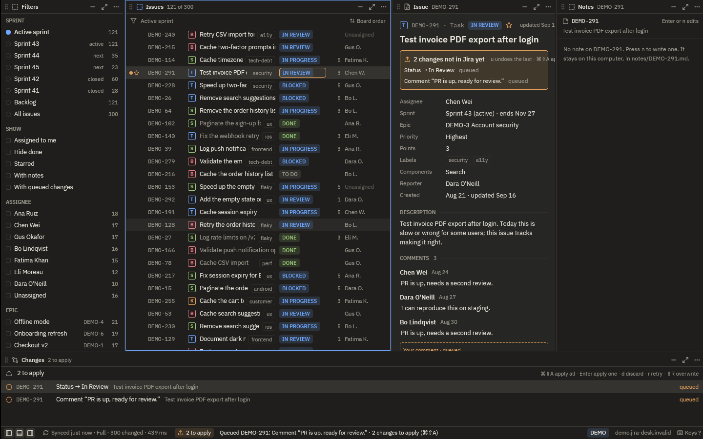
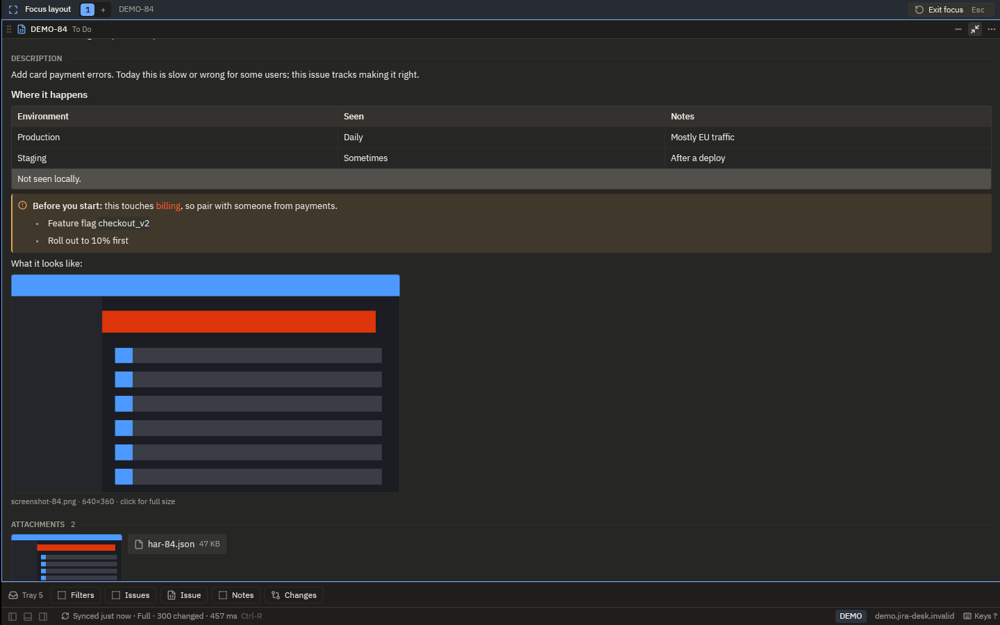
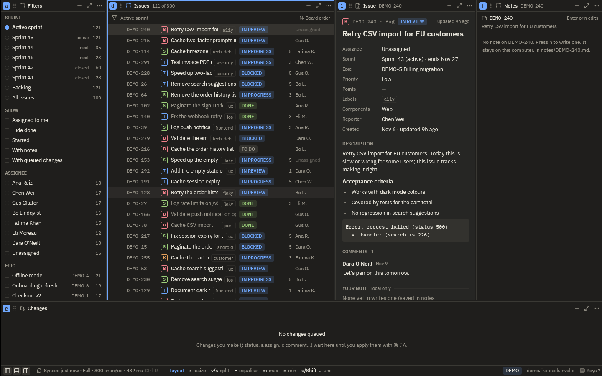
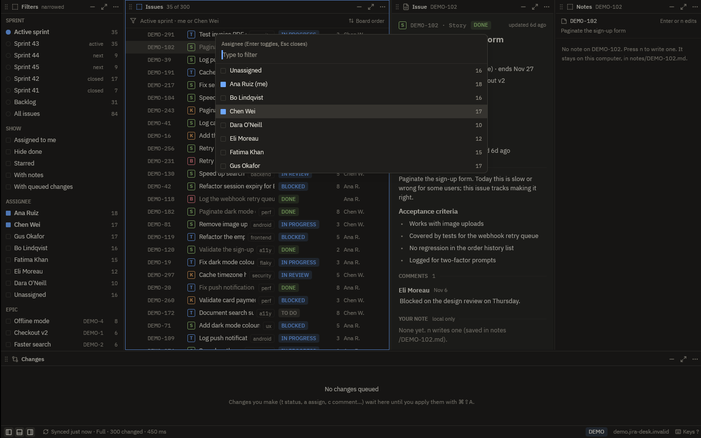

# Jira Desk

A fast, keyboard-first desktop app for reading your Jira issues from a local copy.

Issues sync **one way**, from Jira to your computer, in the background. Anything you change
(status, assignee, labels, comments…) is **queued**, and goes to Jira only when you apply the
queue. Notes and stars live in plain files next to the copy and never leave your computer.

The window works like Chorong, the read-only code viewer: it uses Chorong's layout crates, so you get the
same docks, splits, tabs, Layout mode with jump labels, pane pickers and focus layouts, with
the same keys.



## Try it

```bash
cargo run --release -p jira-desk -- --demo        # 300 made-up issues; --demo 5000 for more
```

Demo mode runs a fake Jira in memory, so everything works there, including applying changes.
Its notes go in a separate `demo/` folder, and it starts from scratch each launch.

## Set it up for your Jira

**[docs/setup.md](docs/setup.md)** walks through it: creating an API token, storing it in the
Keychain, the config, checking it works, and what to do when it doesn't. In short:

1. Create an [API token](https://id.atlassian.com/manage-profile/security/api-tokens).
2. Store it in your Keychain: `security add-generic-password -s jira-desk -a you@example.com -w`
   (paste the token at the prompt).
3. Copy `config.example.toml` to `config.toml` in the data folder (`jira-desk --where`):

   ```toml
   site = "https://your-site.atlassian.net"
   email = "you@example.com"
   token_command = "security find-generic-password -w -s jira-desk"
   jql = "project = ABC AND (sprint in openSprints() OR sprint in futureSprints() OR updated >= -30d)"
   refresh_minutes = 10
   max_image_mb = 500          # downloaded images kept (least recently opened go first)
   ```

The token is never written to the data folder. `jql` decides which issues are kept locally:
keep it to what you work with. For Jira Server or Data Center, see the guide.

## How it stays in sync

- **On launch and every `refresh_minutes`** (⌘R any time), it fetches only the issues in your
  JQL updated since the last refresh, with a couple of minutes' overlap. The query uses a
  relative time (`updated >= -12m`), so your Jira profile's time zone doesn't matter.
- **Once a day, or when the JQL changes** (⇧⌘R any time), a full refresh lists every key in
  scope with its last-updated time, downloads only those that differ from your copy, and drops
  issues that were deleted or left the JQL.
- The first refresh downloads everything in one pass. Sprints, story points, epics and board
  order are custom fields with different ids on each site; they are found by type from Jira's
  field list (`[fields]` in `config.toml` overrides them if needed).
- Offline, everything still works from the copy: the status bar says "Offline" and why.

## Changing things

Every change goes in the queue (the **Changes** pane, ⌥5) and shows at once in the app, marked
**QUEUED**. ⇧⌘A applies the queue after showing you what it will send.

| Key | Change |
|---|---|
| t | Status… |
| a / i | Assign… / assign to me |
| ⇧L | Labels… (type a new one to add it) |
| c | Comment (Enter for new lines, ⌘Enter to queue; Esc keeps a draft) |
| r | Edit the summary |
| p / ⇧P | Story points / priority… |
| m | Move to a sprint… |
| u | Undo the last queued change on this issue |

- A second change to the same field replaces the first, and changing it back removes it.
- **Applying never overwrites someone else's edit.** Each issue is read from Jira again first.
  If a field you changed was changed in Jira after you queued yours, that change stops as a
  **conflict** and shows both values. `r` retries it, and ⇧R overwrites theirs. Labels are sent
  as add/remove, and comments are added, so neither can conflict.
- A change Jira refuses (a status your workflow can't reach from here, say) stops as
  **failed**, with Jira's reason. Applied changes stay listed as history until you clear them (⇧C).

## The search bar

`/` (or ⌘F) opens one bar for everything that narrows the list. Text you type searches key,
summary, labels, epic and people as you type. A field word followed by Tab or `:` makes a
chip, a filter you pick a value for:

| Type | Then | Gets you |
|---|---|---|
| `sprint`, `assignee` (or `who`), `label`, `epic`, `status`, `tag` | Tab or `:` | a chip for that filter, with its values matched loosely (`prog` → In Progress) and counts |
| two letters of one (`as`, `st`, `ta`…) | Tab or `:` | the same; single letters never make a chip, so "a fix" stays text |
| `#` | (nothing) | a chip for your own tags straight away: `#per` finds #perf. Jira labels are `label` / `la` |
| an issue key (`ABC-123`) | Enter | that issue |

- In a chip, ↑/↓ choose and Tab or Enter takes the value (taking a ticked one removes it).
- The chips *are* the list's filters: the ones set with `f` chords or the Filters pane show
  in the bar too, and the bar's show there.
- Backspace at the start of the text selects the last chip, and a second removes it. ⇧Tab
  reopens the last chip to change it. Backspace in an empty chip, or Esc, cancels it.
- Esc steps back: a selected chip, then an open chip, then the bar (clearing its text;
  the chips stay). Enter keeps the text and closes the bar.

The `f` chords stay as precise shortcuts: `f s` goes straight to the sprint picker.

## Rich text

Descriptions and comments are drawn from Jira's rich text, not shown as raw markup:
headings, lists and checklists, code blocks, quotes, info/warning panels, collapsible sections
(shown open), tables (header cells, merged columns, cell colours, and whatever the cells hold),
text colour and highlight, bold, italic, underline, strikethrough and @mentions.

- **Links are clickable.** A link to an issue in your copy reads "ABC-12 Its summary" and opens
  in a tab; a web link (`https:`, `http:`, `mailto:`) opens in the browser. Anyone who can edit
  an issue writes its links, so any other kind (`file:`, a network share, another app's own
  links) is not opened: it is copied, for you to open yourself if you trust it.
- **Images attached to the issue show inline**, downloaded in the background into
  `attachments/` the first time you look at the issue (click one for full size). Only files
  named and shaped like images are kept there. Other files are
  listed under Attachments and open in the browser. Jira doesn't say which attachment an image
  in the text is, so they are matched by file name, then in order.



## Notes, stars and tags

`n` (or Enter in the Notes pane) edits a note on the current issue, and Esc or ⌘S saves it.
Each note is a plain Markdown file, `notes/ABC-123.md`, so you can also grep, edit or back them
up outside the app. `s` stars an issue. **⇧T** adds your own tags: any words you like (type one
that doesn't exist to create it), shown as `#tag` chips on the list and the issue, with a "Your
tags" section in the Filters pane and `f ⇧T` (or `f g`) to filter by them. Notes, stars and tags never go to
Jira, and each has its own filter.

## A focus series

Pick issues with **x** (a blue mark on the row; the selection moves on, so `x x x` picks a run;
⇧X clears), then **⇧F** opens them as a focus layout, one issue per page, the way Chorong opens a
tour's steps. With nothing picked, ⇧F takes the listed issues (the first 40). The page chips
along the top are the issue keys; **]** and **[** step through them, ⌘K 1…9 jumps, **Tab** and
⇧Tab bring another open issue from the tray into the focused spot, and Layout mode splits a page.
Esc goes back to your normal layout and closes the tabs the series opened.

To build a page by hand, as in Odin: **⌘K ⇧N** (New focus page) starts a focus layout with the
focused pane, or adds a page to one, and opens the tray picker. Pick panes from the tray one
after another, or press **Tab** to add issues instead: type to find one by key or summary,
**Enter** puts it to the right and **⇧Enter** below, and the picker stays open for the next
(Esc when done; Backspace on an empty query, or the Issues chip, goes back to the tray). The
Board is offered at the top of that list too, so a page can have it whether or not it was open.
**⌘K A** does the same for the page you're on. In a focus layout **⌘W** sends the focused pane to the tray
(it closes it only outside one).

## When an issue changes underneath you

Jira keys get reused: an old ticket is rewritten for new work, or deleted and recreated. Your
queued changes, note, star and tags are filed under the key, so Jira Desk checks that the key
still means the same thing. The first time you attach anything to an issue, it keeps a
fingerprint (Jira's internal id, when it was created, its type, project, summary and
description). It's kept in `identity.json`, apart from the cache, which every sync replaces and
which you can delete; comparing with it rather than with the last sync also catches a ticket
rewritten a little at a time. Every sync, and again just before your changes are applied, the
issue is compared with it. When your own changes are applied, the fingerprint follows the issue
as Jira returns it, so your edits (a renamed summary, say) never read as someone else's. It's a **material change** when Jira's internal id or creation time is different (another
issue under the key), the type or project changed, or the summary was rewritten (few words in
common), or reworded alongside a rewritten description. Ordinary edits (status, assignee, a
reworded summary, a description filled in) are not.

A material change opens a **review**: a red banner on the issue showing what it was and what it is
now, an alert on its row, and a "Needs review" section in the Changes pane. Its queued changes
are **held**: applying sends nothing for it until you decide, with **v**:

- **Same work:** the fingerprint follows the issue as it is now, and the changes can be applied.
- **Repurposed:** your note, star, tags and its queued changes are moved to
  `archive/ABC-123-<time>/` (the note as `note.md`, the rest with what the issue was in
  `detached.json`), and the key starts clean.
- **Decide later:** everything stays held. `f v` lists the issues waiting for review.

From a terminal: `jdesk reviews`, then `jdesk resolve ABC-123 keep|detach`.

## The window

| Pane | Shows |
|---|---|
| **Filters** (left dock, ⌥1) | Sprints, quick filters (mine, hide done, starred, noted, queued), assignees, epics, statuses, labels, each with counts |
| **List** (⌥2) | The filtered list. A dot marks queued changes, a star starred issues, a page icon notes |
| **Preview** (⌥3) | The selected issue: fields, description, links, comments, your note |
| **ABC-123** tabs | An issue in its own tab (Enter or `o`), beside the Preview pane |
| **Notes** (right dock, ⌥4) | Your note on the current issue |
| **Changes** (bottom bar, ⌥5) | The queue and its history |
| **Board** (⌥6) | The list as status columns, opened as a focus layout (Esc goes back and closes it) |

Panes, docks and splits are Chorong's, with Chorong's keys, so one set works in both. Drag
tabs and dividers with the mouse, or press `w` for Layout mode:

| In Layout mode (`w`) | Does |
|---|---|
| a letter or 1–9 | Jump to the pane wearing that label |
| arrows, ⇧ arrows, ⌥ arrows | Move focus; move the pane; move its whole group |
| `p` | Move this pane to… (a dock, the bottom bar, beside or into another pane) |
| `v`, `s` | Split right, split down |
| `r` | Resize (arrows; ⇧ for fine steps), `=` equalise |
| `m`, `n` | Maximise (a focus layout), minimise |
| `t`, `b`, Tab | Send to the tray, bring from the tray, cycle the tray |
| `x` | Close the pane |
| `h` | Reopen the last focus layout |
| `u`, ⇧U | Undo, redo the layout |
| `w`, Enter, Esc | Leave |

The same things have direct chords: ⌘K and an arrow splits, ⌘K ⌘arrow moves focus, ⌘K M
maximises, ⌘K N minimises, ⌘K A brings from the tray, ⌘K Space is Layout mode, ⌘K Z / ⇧Z
undo and redo; in a focus layout ⌘K ] and ⌘K [ step pages, ⌘K 1…9 jump, ⌘K ⇧N adds a page.
⌘K / picks a pane by name and Ctrl-Tab switches to recent panes. The layout is saved.

Half-way through any chord (⌘K, `f`, …) a card above the status bar lists the keys that can
follow and what each does, from the live keymap. Take your time: the chord stays open until
the next key, and Esc or a click cancels it.



## Keyboard

Press `?` for the full list, or ⇧⌘P (or Shift twice) to find a command by name and run it; both read the keymap, so they always match. To change a key, put a
`keymap.json` in the data folder, in the same format as
[`app/keymap/default.json`](app/keymap/default.json) (Zed's keymap format; `cmd` is Ctrl off
macOS). Later bindings win.

| Key | Does |
|---|---|
| j / k, ↓ / ↑ | Move in the focused pane (or scroll an issue) |
| g g / ⇧G, Ctrl-D / Ctrl-U | Top / bottom, page down / up |
| Enter | Open the issue in a tab, or toggle a filter |
| ⌘P | Go to any issue (fuzzy) |
| / or ⌘F | The search bar: text, plus chips for any filter (below) |
| f s, f a, f e, f l, f t | Pick sprint, assignees, epics, labels, statuses |
| f m, f d, f 8, f n, f q | Only mine, hide done, only starred, only noted, only queued |
| f ⇧T (or f g), f v | Your tags…, only issues waiting for review |
| f o, f x | Sort, clear filters |
| s, n, ⇧T | Star, note, your tags |
| x, ⇧X, ⇧F | Pick, clear picks, open as a focus series |
| ], [, Tab | In a focus layout: next/previous page, bring an issue from the tray |
| v | Review an issue that changed a lot in Jira |
| o, ⇧O, y, ⇧Y | Open in a tab, open in browser, copy key, copy link |
| ⌘R, ⇧⌘R | Refresh, full refresh |
| ⌘, | Settings: storage meter and connection |
| ⇧⌘P, or Shift twice | Command palette: run any command by name, with its key shown |
| ⇧⌘A | Apply the queue |
| ⌥1 … ⌥6 | Filters, Issues, Issue, Notes, Changes, Board |
| w | Layout mode (Chorong's) |
| ⌘B, ⌥⌘B, ⌘J | Left dock, right dock, bottom bar |



## Your data

```
Jira Desk/                    (jira-desk --where)
  config.toml                 site, sign-in, JQL, refresh interval
  cache.sqlite                Jira's issues as last downloaded. Safe to delete: it is fetched again
  queue.json                  your queued changes and recent history (written after every change)
  attachments/                images from issues you've looked at (safe to delete)
  journal/2026-11.jsonl       append-only record of every change, note, star, tag and review
  identity.json               fingerprints of issues you attached things to
  reviews.json                issues that changed a lot in Jira, and what you decided
  archive/ABC-123-<time>/     what you detached from a repurposed key
  notes/ABC-123.md            your notes
  local.json                  stars
  ui.json                     the last filter
  layout/                     the window layout
  keymap.json                 (optional) your keys
  control.sock                while the app is open: how jdesk reaches it (only you can)
```

The folder is yours alone: Jira Desk sets it to mode 0700 (only you can open it) each time it
opens, and refuses a folder someone else owns. That keeps your copy of Jira and your notes from
other people on the same computer, and `control.sock` with it.

### How much space it takes

**⌘,** opens Settings, with a storage meter: the data folder's total and a bar split by what
the space is for (the issue copy, downloaded images, the journal, your notes and archive, the
queue and other small files), each with its size, share and what you can do about it. `r`
measures again (it also re-measures after each sync while Settings is open), `⇧D` clears the
downloaded images, and `y` copies the folder's path. Settings also shows the connection
(site, JQL, refresh interval, last sync, who you're signed in as); change those in
`config.toml`.

As a guide, the issue copy is about 3 KB per issue (300 issues ≈ 1 MB) plus their comments,
and images are only the ones in issues you've opened. Images are capped at `max_image_mb`
(500 MB unless you set it in `config.toml`; 0 for no limit): past it, the images of the issues
you opened least recently are deleted, never one on screen, and they download again if you
open those issues. Settings shows the cap under "Downloaded images".

## If something goes wrong

Everything you do that isn't in Jira yet is also written to an **append-only journal**
(`journal/YYYY-MM.jsonl` in the data folder), one line per event, flushed to disk *before*
the file it describes is replaced: every change queued, edited, dropped, applied, refused or
retried (with what the field was), every note's full text when saved, every star, and which
issues each sync changed. Lines are only ever added; a new file starts each month.

A refresh never touches your queue, notes or stars: it only replaces the cache, which is
Jira's data. But if `queue.json`, a note or `local.json` is lost or damaged (a crash, a bad
sync of the folder, an accident), the journal puts them back:

```bash
jdesk journal --last 20     # what happened, newest last
jdesk recover               # compares the journal with the files; changes nothing
jdesk recover --write       # copies the current files to recovery-<time>/, then restores
```

Recovery keeps any queued change found only in `queue.json`, and a line cut short by a crash
is skipped rather than stopping it. The issues themselves aren't journaled: they're Jira's,
and ⇧⌘R downloads them again.

## The `jdesk` command, agents and links

`jdesk` is Jira Desk without the window: for you, scripts and agents. **While the app is open
on the same data folder, every command goes through the app** (it is the only writer, so
nothing is lost, and its window follows along); otherwise `jdesk` works on the files itself.
Add `--json` to any command for the whole answer as JSON.

```bash
# Your data (with or without the app)
jdesk list --sprint active --assignee ana --tag perf --text "cart"   # ends "35 issues · 85 pts"
jdesk sprints --assignee ana                # story points per sprint and the backlog
jdesk show ABC-123
jdesk queue
jdesk change ABC-123 status in progress     # queued, not sent: names are matched loosely
jdesk change ABC-123 assign ana             # assign me / none
jdesk change ABC-123 labels +perf -flaky    # also summary, points, priority, sprint, comment
jdesk star ABC-123 [on|off]
jdesk tag ABC-123 perf [on|off]
jdesk note ABC-123 "ask Bo about the API"
jdesk reviews ; jdesk resolve ABC-123 keep|detach
jdesk sync [--full]
jdesk apply [ID…]                           # SENDS the queue to Jira

# The app (needs it open)
jdesk app state                             # pane, layout, selection, filter, visible issues, queue
jdesk app commands                          # every command palette command and its key
jdesk app run hide done                     # run one by (part of) its name
jdesk app open ABC-123
jdesk app search "cart #perf who:ana st:prog"
jdesk app series ABC-1 ABC-2 ABC-3

jdesk journal --last 20 ; jdesk recover [--write] ; jdesk where
```

A name that matches more than one thing (`jdesk app run pane`) lists the candidates instead
of guessing, and a value Jira doesn't have (`status nonsense`) is refused with the ones it
does. Failures exit 1.

**For an agent:** `jdesk mcp` serves the same commands as MCP tools on stdin/stdout:
`list_issues`, `list_sprints`, `show_issue`, `list_queue`, `list_reviews`, `queue_change`, `set_star`,
`set_tag`, `note`, `resolve_review`, `sync`, `apply_queue`, and `app_state`, `app_commands`,
`app_run`, `app_open`, `app_search`, `app_series`. For Claude Code:

```bash
claude mcp add jira-desk -- /Applications/Jira\ Desk.app/Contents/MacOS/jdesk mcp
```

Changes an agent queues wait in the Changes pane like yours; only `apply_queue` sends them,
and its description tells the agent to call it only when you asked. `app_run` (and
`jdesk app run`) refuses the commands that send or throw away queued work (apply, retry,
overwrite, discard, undo, clear history). Tools say what they touch (MCP annotations:
read-only, local, or Jira), and answers that carry issue text say it comes from Jira, written
by other people, so it is data for the agent, never instructions.

**Links:** `jiradesk://open/ABC-123` (or `browse/ABC-123`), `jiradesk://search?q=cart%20%23perf`
and `jiradesk://series/ABC-1,ABC-2` open the app on that issue, search or series. Links can
come from anywhere, so they only show things: they never change data or run commands. The
Mac app registers the scheme; on Linux, install `linux/jira-desk.desktop` and run
`xdg-mime default jira-desk.desktop x-scheme-handler/jiradesk`. `jira-desk LINK` also works,
and hands the link to the copy already open.

Only one Jira Desk opens per data folder; a second launch passes its links to the first and
stops.

## Building

Rust stable. The window is [GPUI](https://www.gpui.rs) (Zed's UI framework), with the layout
from Chorong's published crates (`cho-layout`, `cho-layout-ui`, pinned to 0.1.1).

**macOS** needs Xcode with the Metal toolchain, since GPUI compiles its shaders at build time
(`xcodebuild -downloadComponent MetalToolchain`). Then:

```bash
scripts/bundle-macos.sh               # target/release/Jira Desk.app; --universal for both CPUs
```

**Linux** needs these packages, then `cargo build --release`:

```bash
sudo apt-get install -y libxkbcommon-dev libxkbcommon-x11-dev libwayland-dev libvulkan-dev \
  libx11-xcb-dev libxcb1-dev libfontconfig-dev libfreetype-dev clang pkg-config
```

A cold build compiles GPUI and takes several minutes. `cargo test --workspace` runs the engine
tests (sync, queue, conflicts, the HTTP client against a fake Jira Cloud server) and the app's.

## Not yet

- The description is read-only (comments can be added).
- One window: panes can't be popped out into windows of their own.
- Images linked from other sites (not attached to the issue) show as a link, not inline.
- Jira Server/Data Center descriptions are wiki markup and are shown as plain text.
- The status picker offers every status seen locally. Jira decides which moves your workflow
  allows, and a move it refuses comes back as a failed change with the moves it does allow.
- Only the latest comments Jira includes with an issue are kept (the count shows when there are
  more).
- Jira Server/Data Center support follows Jira's documented v2 API, but only Jira Cloud's is
  covered by the tests.

## Code

- `crates/jdesk-core`: no UI. `client.rs` (REST), `sync.rs`, `store.rs` (SQLite cache),
  `queue.rs` (changes and conflict checks), `sidecar.rs` (notes), `filter.rs`, `parse.rs` and
  `adf.rs` (Jira's JSON and rich text), `demo.rs` (the fake Jira), and the `jdesk` command.
- `app`: the window. `view.rs` (keys, overlays, status bar), `panes.rs` (what each pane draws),
  `state.rs` (shared state, background sync and apply), `picker.rs`, `input.rs`, `keymap.rs`.

## Licence

Jira Desk is licensed under the [Functional Source License, Version 1.1, ALv2 Future
License](LICENSE.md) (FSL-1.1-ALv2). You may use, copy, change and share it for any purpose
except offering a competing commercial product or service. Each release also becomes available
under the Apache License 2.0 two years after it is published.
